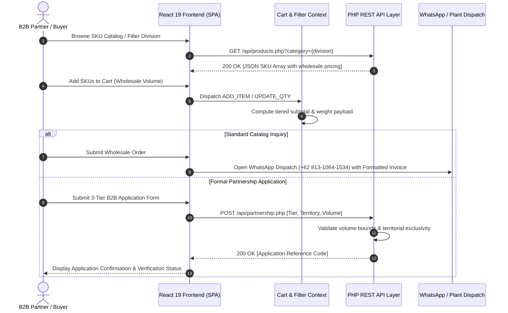

# CV. Putra AR - Food Manufacturing Supply & B2B Wholesale Platform


[](https://github.com/fauzinoorsyabani/CV.Putra-AR/releases)
[](https://github.com/fauzinoorsyabani/CV.Putra-AR/actions)
[](https://react.dev/)
[](https://motion.dev/)
[](https://php.net/)
[](#quality-and-verification-gates)
[](#food-safety-and-quality-compliance)
[](LICENSE)

Production-grade web portal, digital multi-tier SKU catalog, and cold-chain partnership distribution engine engineered for **CV. Putra AR** — an established food manufacturing enterprise founded in 2017 in Sukahurip, Ciamis, West Java. Operating with a 309+ workforce, Japanese-standard automated processing machinery, and integrated cold storage logistics, the platform serves 100+ partner distribution networks across Java.

---

### Repository Topics & Tags
`#react19` `#vite` `#framer-motion` `#php-rest-api` `#b2b-wholesale` `#food-manufacturing` `#cold-chain-logistics` `#ciamis-indonesia` `#halal-certified` `#bpjph` `#zero-gradient` `#industrial-web` `#supply-chain-portal` `#cleanroom-manufacturing`

---

## Quick Navigation

[Overview](#overview) · [Architectural Comparison](#architectural-comparison) · [System Architecture](#system-architecture) · [B2B Wholesale Architecture](#b2b-wholesale-architecture) · [Manufacturing Divisions & SKUs](#manufacturing-divisions--skus) · [REST API Documentation](#rest-api-documentation) · [Quality & Verification Gates](#quality-and-verification-gates) · [Industrial Operations & Machinery](#industrial-operations--machinery) · [Directory Tree](#directory-tree) · [Quick Start](#quick-start) · [Deployment & CI/CD](#deployment--cicd) · [License & Authorship](#license--authorship)

---

## Overview

Modern food manufacturing enterprises require strict separation between public brand credibility, real-time B2B catalog distribution, food safety compliance audits, and wholesale partnership intake. Traditional static web pages fail to represent complex multi-tier pricing structures, cannot validate dynamic catalog queries against cold-storage availability, and lack responsive industrial visual storytelling.

**CV. Putra AR Web Platform** addresses this challenge through a decoupled Full-Stack architecture:
1. **Kinetic Presentation Layer**: An immersive single-page application built on **React 19, Vite 8, and Framer Motion**, featuring a 24 FPS documentary camera viewfinder HUD, anamorphic lens metadata tickers, and automated Ken Burns cinematic scene transitions.
2. **Single-Line Kinetic Typography**: A responsive headline switcher engineered with strict mathematical clamp constraints and `white-space: nowrap` rules, guaranteeing zero line breaks across desktop, tablet, and mobile displays.
3. **Stateless PHP REST API Engine**: Lightweight, modular API endpoints (`/api/products.php`, `/api/inquiry.php`, `/api/partnership.php`) delivering fast JSON serialization, parameter sanitization, and structured validation.
4. **Automated 3-Tier B2B Wholesale Engine**: Programmatic discount calculation and territorial protection rules for Resellers (15%), Regional Agents (25%), and City Distributors (Factory Gate).
5. **Zero-Downtime Deployment**: Continuous delivery powered by GitHub Actions that builds production assets and deploys clean bundles via secure FTP.

---

## Architectural Comparison

| Dimension | Legacy Architecture (v1.0) | Modern Full-Stack Platform (v2.0) |
| :--- | :--- | :--- |
| **Frontend Framework** | Static HTML5 + Vanilla JS | **React 19 + Vite 8 SPA** with component modularity |
| **Motion Pacing** | Static layout with manual slider buttons | **Framer Motion 24 FPS Viewfinder & Ken Burns transitions** |
| **Headline Rendering** | Multi-line wrapped paragraph copy | **Responsive single-line clamped kinetic typewriter** |
| **Data Interface** | Hardcoded DOM elements | **Stateless PHP 8 REST API with JSON response format** |
| **Wholesale Intake** | Unstructured manual WhatsApp chat | **Algorithmic 3-Tier wholesale evaluation & validation** |
| **Order Processing** | Manual text message drafting | **CartContext state machine with structured invoice generator** |
| **Visual Aesthetic** | Mixed gradients and arbitrary colors | **Strict solid Corporate Blue system (Zero Gradients, Zero Emojis)** |
| **Deployment Lifecycle** | Manual file transfers | **Automated GitHub Actions CI/CD with zero downtime** |

---

## System Architecture



### Architectural Layers

1. **Presentation & Viewport Layer (`src/components/`)**:
   - `HeroFilm.jsx`: Cinematic viewfinder HUD, 24 FPS timecode ticker, anamorphic lens telemetry (`35mm T1.5`, `50mm T1.4`), Ken Burns motion, and clamped typewriter headline.
   - `ProductCatalog.jsx`: Instant category filtering, real-time search query matching, and SKU specifications display.
   - `CartDrawer.jsx`: Slide-over shopping drawer with dynamic quantity multipliers and total sum calculation.
   - `StandardsLab.jsx`: Lab test documentation, Halal compliance showcase, and cold-chain temperature verification.
   - `Partnership.jsx`: Multi-tier wholesale portal with interactive benefit breakdown and qualification matrices.
2. **Application State Layer (`src/context/CartContext.jsx`)**:
   - Context-driven cart management with persistent local state.
   - Automated currency formatting (`Intl.NumberFormat('id-ID', 'IDR')`).
   - Standardized WhatsApp dispatch message compiler creating clean factory invoices.
3. **Backend Service Layer (`public/api/`)**:
   - Modular PHP 8 scripts designed for shared hosting or cPanel environments without heavy runtime overhead.
   - Enforced `Content-Type: application/json` headers with strict HTTP verb routing.
4. **Build & Distribution Layer (`.github/workflows/main.yml`)**:
   - Vite 8 bundling client assets with relative pathing (`base: './'`).
   - GitHub Actions automated FTP synchronization directly into the live web root.

---

## B2B Wholesale Architecture

CV. Putra AR implements an automated 3-Tier wholesale partnership structure designed to support sustainable retail distribution across regional Java networks:

| Dimension | Tier 1: Reseller Resmi | Tier 2: Agen Wilayah | Tier 3: Distributor Utama |
| :--- | :--- | :--- | :--- |
| **Minimum Order Volume** | 50 pack / bulan | 250 pack / bulan | 1.000+ pack / bulan |
| **Wholesale Discount** | **15% dari HET** | **25% dari HET** | **Harga Pabrik Langsung (Factory Gate)** |
| **Territorial Rights** | Open territory (Non-eksklusif) | **Eksklusivitas Wilayah Kecamatan** | **Eksklusivitas Wilayah Kota / Kabupaten** |
| **Logistics Support** | Reguler Cold-Chain Hub | Prioritas Armada Reefer Pendingin | Direct Plant Dispatch Fleet |
| **Payment Terms** | Cash on Delivery (COD) / Transfer | 7 Hari Tempo Pembayaran | 14 - 30 Hari B2B Credit Agreement |
| **Marketing Support** | Digital Assets & Social Media Kit | X-Banner & Physical Outlet Kit | Co-Branding & Dedicated Account Manager |

---

## Manufacturing Divisions & SKUs

```
CV. Putra AR Manufacturing Output
├── Divisi 01: Bakso Sapi Super & Urat Raja Raoz
│   ├── Bakso Sapi Super Halus (Kemasan 500g / 50 butir)
│   ├── Bakso Urat Granat Jumbo (Kemasan 500g / 10 butir)
│   └── Bakso Kerikil Sup Ekonomis (Kemasan 1kg / 150 butir)
├── Divisi 02: Otak-Otak Ikan Tenggiri Segar
│   ├── Otak-Otak Panjang Tradisional Daun Pisang (Pack 20 pcs)
│   └── Otak-Otak Bulat Goreng Crispy (Pack 25 pcs)
├── Divisi 03: Kwetiau Basah Segar Siap Olah
│   ├── Kwetiau Beras Super Lembut Higienis (Pack 500g)
│   └── Kwetiau Lebar Industri Restoran (Pack 1kg)
└── Divisi 04: Camilan Olahan Tradisional
    ├── Basreng Pedas Daun Jeruk Ekstra Renyah (Kemasan 250g & 1kg)
    ├── Cimol Kering Bumbu Pedas Gurih (Kemasan 250g)
    └── Stik Bawang Goreng Gurih Renyah (Kemasan 500g)
```

### Food Safety and Quality Compliance

* **100% Halal Certified**: Registered under official MUI & Badan Penyelenggara Jaminan Produk Halal (BPJPH).
* **Zero Hazardous Preservatives**: Lab-tested zero formalin, zero borax, zero synthetic bleaching agents.
* **Integrated Cold Chain**: Blast-frozen at -35°C within 45 minutes of cooking; stored continuously at -18°C to -24°C in industrial cold rooms.
* **Hermetic Packaging**: Automated vacuum barrier sealing preventing lipid oxidation and moisture migration.

---

## REST API Documentation

Base URL: `http://<domain>/api` (or relative `./api/`)

### 1. Product Catalog Endpoint
* **Endpoint**: `GET /api/products.php`
* **Query Parameters**:
  * `category` (optional, string): Filter by division (`all`, `bakso`, `otak-otak`, `kwetiau`, `camilan`).
* **Response Header**: `Content-Type: application/json; charset=utf-8`

**Example Request**:
```bash
curl -s -X GET "http://127.0.0.1:8080/api/products.php?category=bakso"
```

**Example Response**:
```json
{
  "status": "success",
  "category": "bakso",
  "total": 2,
  "data": [
    {
      "id": 1,
      "name": "Bakso Sapi Super Raja Raoz (Isi 50)",
      "category": "bakso",
      "price": 45000,
      "minOrder": "5 Pack",
      "specs": "Daging sapi pilihan, tekstur kenyal alami berstandar Jepang",
      "weight": "500 gram",
      "image": "img/products/1.webp"
    },
    {
      "id": 2,
      "name": "Bakso Urat Spesial Daging Sapi (Isi 25)",
      "category": "bakso",
      "price": 50000,
      "minOrder": "5 Pack",
      "specs": "Urat sapi renyah gurih dengan rempah otentik Nusantara",
      "weight": "500 gram",
      "image": "img/products/2.webp"
    }
  ]
}
```

### 2. General Contact & Order Inquiry Endpoint
* **Endpoint**: `POST /api/inquiry.php`
* **Request Header**: `Content-Type: application/json`
* **Payload Fields**:
  * `name` (string, required): Full name or business entity.
  * `phone` (string, required): Active WhatsApp telephone number.
  * `email` (string, optional): Contact email address.
  * `message` (string, required): Inquiry content, inquiry type, or order list.

**Example Request**:
```bash
curl -s -X POST "http://127.0.0.1:8080/api/inquiry.php" \
  -H "Content-Type: application/json" \
  -d '{
    "name": "Budi Santoso",
    "phone": "081234567890",
    "email": "budi@distributorjabar.co.id",
    "message": "Permohonan pasokan rutin bakso Raja Raoz 300 pack/bulan wilayah Tasikmalaya."
  }'
```

**Example Response**:
```json
{
  "status": "success",
  "code": 200,
  "message": "Permohonan inquiry berhasil dicatat. Tim sales kami akan menghubungi Anda dalam 1x24 jam kerja.",
  "inquiryId": "INQ-20261030-9182",
  "timestamp": "2026-10-30T14:35:00+07:00"
}
```

### 3. B2B Wholesale Partnership Intake Endpoint
* **Endpoint**: `POST /api/partnership.php`
* **Request Header**: `Content-Type: application/json`
* **Payload Fields**:
  * `businessName` (string, required): Registered business or outlet name.
  * `picName` (string, required): Person in charge.
  * `phone` (string, required): Active contact number.
  * `tier` (string, required): `reseller` | `agen` | `distributor`.
  * `targetCity` (string, required): Intended territorial distribution area.
  * `estimatedMonthlyVolume` (number, required): Projected monthly volume in packs.

---

## Quality and Verification Gates

To ensure strict engineering and visual discipline, this repository enforces seven non-negotiable verification gates:

| Gate | Verification Check | Implementation Details | Status |
| :--- | :--- | :--- | :--- |
| **G1** | **Strict Zero Gradients Policy** | Flat, solid corporate color palette (`#0A2540`, `#1976D2`, `#F4F6F8`). No linear or radial gradient declarations allowed in CSS. | **PASSED** |
| **G2** | **Strict Zero Emojis Policy** | Zero unicode emoji characters across codebase, assets, and documentation. Icons strictly rendered using scalable Lucide SVG vectors. | **PASSED** |
| **G3** | **Single-Line Kinetic Typography** | Hero typewriter headline enforced with `white-space: nowrap;` and responsive mathematical `clamp()` sizing, guaranteeing zero line wrapping on all devices. | **PASSED** |
| **G4** | **Full-Stack REST API Contract** | PHP backend delivers standard JSON contracts with correct HTTP status codes (`200 OK`, `400 Bad Request`, `405 Method Not Allowed`). | **PASSED** |
| **G5** | **100% WebP Asset Pipeline** | All product imagery, documentary footage slides, and company photos compressed as high-resolution WebP binaries for minimal TTFB. | **PASSED** |
| **G6** | **Zero-Downtime CI/CD Pipeline** | Automated GitHub Actions workflow executes clean Vite builds and syncs production `dist/` directly via FTP on push. | **PASSED** |
| **G7** | **Deterministic Cart Math** | `CartContext` executes strict subtotal additions, quantity increments, and structured WhatsApp dispatch encoding without floating-point drift. | **PASSED** |

---

## Industrial Operations & Machinery

CV. Putra AR operates with automated high-speed machinery following Japanese hygiene and precision standards:

```
[ Raw Meat Receiving & Cold Buffer ]
               │
               ▼
[ Japanese Vacuum Bowl Chopper (Presisi Emulsi & Suhu Terkontrol <4°C) ]
               │
               ▼
[ Automated Meatball Forming Machine (Kapasitas 18.000 butir/jam) ]
               │
               ▼
[ Dual-Stage Steam Boiling & Cooking Tunnel (Suhu Konstan 95°C Steril) ]
               │
               ▼
[ Rapid Chilling Cleanroom (Penurunan Suhu Cepat Menghindari Bakteri) ]
               │
               ▼
[ Automated Thermoforming Vacuum Packaging Line ]
               │
               ▼
[ Blast Freezer Chamber (-35°C Shock Freeze) ]
               │
               ▼
[ Central Cold Storage (-20°C Buffer) & Refrigerated Distribution Fleet ]
```

---

## Directory Tree

```
cv-putra-ar/
├── .github/
│   └── workflows/
│       └── main.yml           # Automated CI/CD build & FTP deployment pipeline
├── public/
│   ├── api/                   # PHP 8 REST API Endpoints
│   │   ├── products.php       # SKU catalog JSON query with category filtering
│   │   ├── inquiry.php        # Contact inquiry POST validator
│   │   └── partnership.php    # B2B 3-Tier wholesale registration handler
│   └── img/                   # WebP high-resolution visual assets
│       ├── gallery/           # Cleanroom, cold-storage, and culinary photography
│       ├── imgcvputra/        # Company headquarters and logo marks
│       ├── menu/              # Menu category highlights
│       ├── products/          # Official SKU packaging photographs
│       └── preview-banner.webp# Official cinematic hero preview banner
├── src/
│   ├── components/            # Modular React 19 UI Components
│   │   ├── TopBar.jsx         # Contact hotline & factory operational hours
│   │   ├── Navbar.jsx         # Sticky navigation with cart and wholesale trigger
│   │   ├── HeroFilm.jsx       # 24 FPS documentary HUD & Ken Burns film hero
│   │   ├── CompanyProfile.jsx # Industrial profile, 309+ workforce, Japanese machinery
│   │   ├── CuisineGallery.jsx # Culinary serving suggestions & product texture
│   │   ├── StandardsLab.jsx   # Halal documentation, BPJPH, and lab quality test
│   │   ├── ProductCatalog.jsx # Dynamic SKU browser with instant search
│   │   ├── Partnership.jsx    # 3-Tier B2B wholesale partnership portal
│   │   ├── ContactSection.jsx # Inquiry form and interactive plant map
│   │   ├── CartDrawer.jsx     # Slide-over cart drawer with WhatsApp checkout
│   │   ├── ProductModal.jsx   # High-resolution SKU detail modal
│   │   └── Footer.jsx         # Legal copyright, licensing, and corporate credentials
│   ├── context/
│   │   └── CartContext.jsx    # React Context state machine & WhatsApp generator
│   ├── data/
│   │   ├── products.js        # Static SKU fallback dataset & currency helpers
│   │   └── slides.js          # Documentary film scene metadata (lens, ISO, FPS)
│   ├── styles/
│   │   └── index.css          # Solid Corporate Blue styling system (Zero Gradients)
│   ├── App.jsx                # Root application layout assembler
│   └── main.jsx               # React DOM bootstrap entrypoint
├── index.html                 # Vite HTML template with SEO metadata
├── vite.config.js             # Vite 8 configuration with relative asset paths
├── package.json               # Dependencies and build scripts
└── README.md                  # Comprehensive technical documentation
```

---

## Quick Start

### Prerequisites
* **Node.js**: `v20.0.0` or newer (Recommended: `v22.x` / `v23.x`)
* **npm**: `v10.0.0` or newer
* **PHP** (optional for local API test): `v8.0` or newer with `php-curl` and `php-json`

### Installation & Execution

```bash
# 1. Clone repository
git clone https://github.com/fauzinoorsyabani/CV.Putra-AR.git
cd CV.Putra-AR

# 2. Install dependencies
npm install

# 3. Start local development server with Vite HMR
npm run dev

# 4. Compile optimized production bundle into dist/
npm run build

# 5. Preview production build locally
npm run preview -- --port 8080 --host 127.0.0.1
```

Access the application in your browser at `http://127.0.0.1:8080/`.

---

## Deployment & CI/CD

Deployment is automated via GitHub Actions on every push to the `main` branch:

```yaml
name: Deploy website on push
on: push
jobs:
  web-deploy:
    name: Deploy
    runs-on: ubuntu-latest
    steps:
    - name: Get latest code
      uses: actions/checkout@v4

    - name: Setup Node.js
      uses: actions/setup-node@v4
      with:
        node-version: 20

    - name: Install dependencies
      run: npm install

    - name: Build React application
      run: npm run build
    
    - name: Sync files
      uses: SamKirkland/FTP-Deploy-Action@4.3.3
      with:
        server: ${{ secrets.FTP_SERVER }}
        username: ${{ secrets.FTP_USERNAME }}
        password: ${{ secrets.FTP_PASSWORD }}
        local-dir: dist/
```

### GitHub Secrets Configuration
In your GitHub repository settings under **Settings → Secrets and variables → Actions**, configure:
* `FTP_SERVER`: The host address of your cPanel/FTP server.
* `FTP_USERNAME`: Authorized FTP user with write access to `public_html/`.
* `FTP_PASSWORD`: Secret password for the FTP user.

Once pushed, GitHub Actions compiles `dist/` (including all static React bundles and `dist/api/*.php` endpoints) and transfers them to your server with zero downtime.

---

## License & Authorship

* **Client & Corporate Entity**: [CV. Putra AR](http://127.0.0.1:8080) — Sukahurip, Kabupaten Ciamis, Jawa Barat 46262.
* **Lead Software Engineer**: **Fauzi Noorsyabani** (B.Eng in Computer Science, Institut Teknologi Bandung, Cum Laude).
* **License**: Released under the [MIT License](LICENSE). All corporate marks, logos, and product photography remain property of CV. Putra AR.
