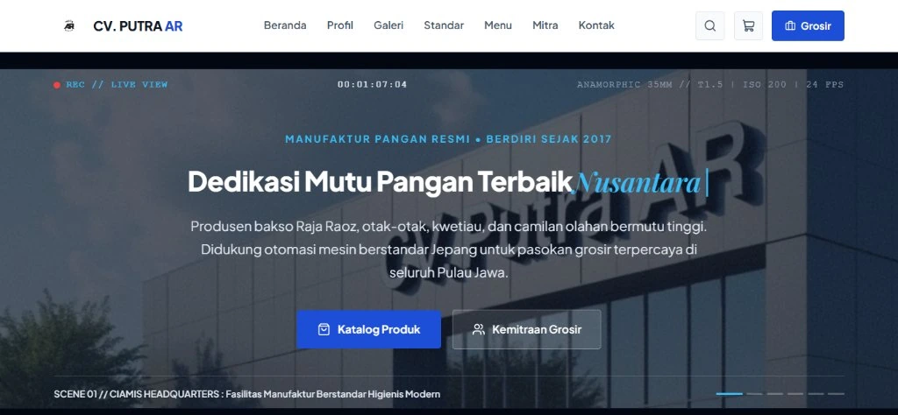

# CV. Putra AR - Food Manufacturing & B2B Wholesale Platform



Platform web resmi dan portal distribusi kemitraan grosir B2B untuk **CV. Putra AR**, perusahaan manufaktur pangan terkemuka yang berpusat di Sukahurip, Kabupaten Ciamis, Jawa Barat. Berdiri sejak tahun 2017, perusahaan memproduksi olahan bakso kemasan beku *Raja Raoz*, otak-otak ikan tenggiri, kwetiau basah higienis, dan aneka camilan gurih dengan standar mesin modern Jepang serta rantai dingin terpadu ke seluruh Pulau Jawa.

---

## Arsitektur Teknologi (Full-Stack Modern)

- **Frontend**: React 19, JavaScript (ESModules), Vite 8
- **Motion & UI**: Framer Motion (Cinematic Film Viewfinder & Ken Burns Motion), Lucide Icons
- **Styling**: Solid Corporate Blue Design System, Strictly Zero Gradient, Zero Emoji
- **Backend & REST API**: PHP 8 REST API (`public/api/products.php`, `public/api/inquiry.php`, `public/api/partnership.php`)
- **Deployment & CI/CD**: GitHub Actions Automated FTP Deployment Workflow (`.github/workflows/main.yml`)
- **Media Optimization**: Format gambar WebP beresolusi tinggi dengan kompresi beban rendah

---

## Fitur Utama Platform

1. **Cinematic Film Hero Section**:
   - Tampilan visual utama bergaya rekaman dokumenter sinematik (*viewfinder HUD*, running timecode 24 FPS, metadata lensa anamorphic, dan efek film grain solid).
   - Animasi rotasi ketik otomatis (*automated typewriter headline*) yang terkunci rapi pada satu baris tunggal responsif.
   - Pergerakan kamera *slow pan & zoom* (*Ken Burns effect*) otomatis tanpa tombol manual.

2. **Katalog Produk Multi-SKU & REST API**:
   - 4 divisi manufaktur utama: Bakso Sapi Super & Urat Raja Raoz, Otak-Otak Ikan Tenggiri Segar, Kwetiau Basah Segar, dan Aneka Camilan Tradisional (Basreng Daun Jeruk, Cimol, Stik Bawang).
   - Filter instan per kategori dan pencarian langsung (*instant search query*).
   - Endpoint REST API JSON untuk integrasi katalog dan penanganan permohonan.

3. **Portal Kemitraan Grosir 3-Tier**:
   - **Tier 1 (Reseller Resmi)**: Min. 50 pack/bulan, diskon grosir 15%, kit promosi digital.
   - **Tier 2 (Agen Wilayah)**: Min. 250 pack/bulan, diskon 25%, eksklusivitas wilayah kecamatan, prioritas armada pendingin.
   - **Tier 3 (Distributor Utama)**: Min. 1.000+ pack/bulan, harga pabrik langsung, eksklusivitas kota/kabupaten, fasilitas tempo pembayaran.

4. **Pusat Pengendalian Mutu & Laboratorium**:
   - Dokumentasi sertifikasi Halal 100% (MUI & BPJPH).
   - Hasil uji laboratorium bebas bahan pengawet kimia berbahaya (tanpa formalin & boraks).
   - Rantai dingin (*cold storage*) dan armada truk pendingin.

5. **Pemesanan Resmi Terintegrasi WhatsApp**:
   - Keranjang belanja interaktif dengan kalkulasi otomatis.
   - Generator format invoice resmi langsung terhubung ke WhatsApp Dispatch Pusat (+62 813-1064-1534).

---

## Struktur Direktori Proyek

```
cv-putra-ar/
├── .github/
│   └── workflows/
│       └── main.yml           # Automated CI/CD build & FTP deploy
├── public/
│   ├── api/                   # PHP REST API Endpoints
│   │   ├── products.php       # Catalog JSON API with category query
│   │   ├── inquiry.php        # Customer inquiry POST endpoint
│   │   └── partnership.php    # Wholesale application endpoint
│   └── img/                   # WebP high-res optimized images
├── src/
│   ├── components/            # Modular React Components
│   │   ├── TopBar.jsx
│   │   ├── Navbar.jsx
│   │   ├── HeroFilm.jsx       # Film-like cinematic hero
│   │   ├── CompanyProfile.jsx
│   │   ├── CuisineGallery.jsx
│   │   ├── StandardsLab.jsx
│   │   ├── ProductCatalog.jsx
│   │   ├── Partnership.jsx
│   │   ├── ContactSection.jsx
│   │   ├── CartDrawer.jsx
│   │   ├── ProductModal.jsx
│   │   └── Footer.jsx
│   ├── context/
│   │   └── CartContext.jsx    # React State & WhatsApp Invoice Builder
│   ├── data/
│   │   ├── products.js        # SKU dataset & currency formatters
│   │   └── slides.js          # Film scenes & lens metadata
│   ├── styles/
│   │   └── index.css          # Solid Corporate Blue styling
│   ├── App.jsx
│   └── main.jsx
├── index.html                 # Vite entry point
├── vite.config.js             # Vite build configuration (base: './')
├── package.json
└── README.md
```

---

## Panduan Menjalankan Proyek Lokal

1. **Instalasi Dependensi**:
   ```bash
   npm install
   ```

2. **Menjalankan Server Pengembangan (Vite HMR)**:
   ```bash
   npm run dev
   ```

3. **Membangun Paket Produksi**:
   ```bash
   npm run build
   ```

4. **Pratinjau Hasil Build**:
   ```bash
   npm run preview
   ```

---

## Kontak & Layanan Resmi Pabrik

- **Alamat Fasilitas**: Desa Sukahurip, Kecamatan Cihaurbeuti, Kabupaten Ciamis, Jawa Barat 46262
- **Hotline Telepon**: (0265) 5401232
- **Layanan WhatsApp**: +62 813-1064-1534
- **Jam Operasional**: Senin - Sabtu: 08.00 - 17.00 WIB
