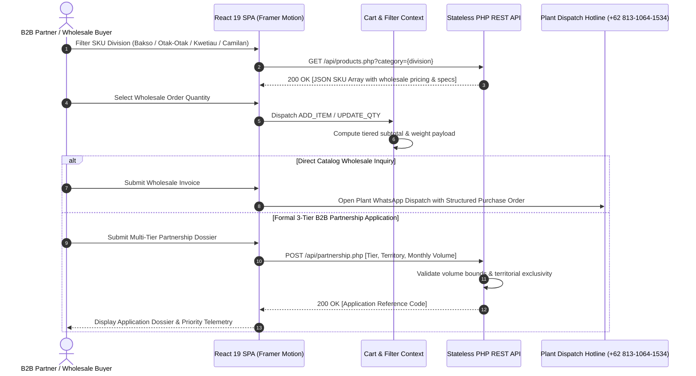

# CV. Putra AR — Food Manufacturing Supply & B2B Wholesale Platform


[](https://github.com/fauzinoorsyabani/CV.Putra-AR/releases)
[](https://github.com/fauzinoorsyabani/CV.Putra-AR/actions)
[](https://react.dev/)
[](https://motion.dev/)
[](https://php.net/)
[](#quality-and-verification-gates)
[](#food-safety-and-quality-compliance)
[](#proprietary-licensing--confidentiality)
[](https://cvputraar.my.id)
[](https://cvputraar.my.id)

Production B2B wholesale platform, digital multi-tier SKU catalog, and cold-chain partnership portal engineered for **CV. Putra AR** — an established food manufacturing enterprise founded in 2017 in Sukahurip, Ciamis, West Java. Operating with a 309+ workforce, Japanese-standard automated machinery, and integrated cold storage distribution, the platform coordinates commercial wholesale supply across 100+ partner networks throughout Java.

* **Official Enterprise URL**: [https://cvputraar.my.id](https://cvputraar.my.id)
* **Production Mirror / Edge**: [https://cv-putra-ar.vercel.app](https://cv-putra-ar.vercel.app)
* **REST API Endpoint**: [https://cvputraar.my.id/api/products.php](https://cvputraar.my.id/api/products.php)
* **Plant Dispatch Hotline**: `(0265) 5401232` · **WhatsApp**: `+62 813-1064-1534`

---

### Repository Topics & Tags
`#react19` `#vite` `#framer-motion` `#php-rest-api` `#b2b-wholesale` `#food-manufacturing` `#cold-chain-logistics` `#ciamis-indonesia` `#halal-certified` `#bpjph` `#zero-gradient` `#industrial-web` `#supply-chain-portal` `#cleanroom-manufacturing` `#enterprise-software` `#proprietary`

---

## Contents

[Overview](#overview) · [The Problem & The Solution](#the-problem--the-solution) · [Why This is Not a Static Catalog](#why-this-is-not-a-static-catalog) · [Architecture](#architecture) · [Kinetic Viewfinder & Single-Line Typography](#kinetic-viewfinder--single-line-typography) · [B2B Wholesale Architecture](#b2b-wholesale-architecture) · [Manufacturing Divisions & Multi-Tier SKUs](#manufacturing-divisions--multi-tier-skus) · [REST API Documentation](#rest-api-documentation) · [Quality & Verification Gates](#quality-and-verification-gates) · [Industrial Operations & Machinery](#industrial-operations--machinery) · [What This Platform Does Not Claim](#what-this-platform-does-not-claim) · [Tech Stack](#tech-stack) · [Directory Tree](#directory-tree) · [Quick Start](#quick-start) · [Deployment, DNS & Cloud Edge](#deployment-dns--cloud-edge) · [Proprietary Licensing & Confidentiality](#proprietary-licensing--confidentiality) · [Authorship & Engineering Credits](#authorship--engineering-credits)

---

## Overview

Modern food manufacturing enterprises operate at the intersection of strict hygiene standards, cold-chain logistical constraints, and multi-tier wholesale distribution. Traditional static web brochures fail to bridge the gap between high-volume commercial buyers and factory dispatch: they cannot calculate dynamic tiered discounts, cannot communicate lab-tested food safety compliance, suffer from unstructured inquiry handling, and lack the industrial visual storytelling required to project manufacturing scale.

**CV. Putra AR Web Platform** solves this through a decoupled Full-Stack architecture:
1. **Kinetic Presentation Layer**: Built on **React 19, Vite 8, and Framer Motion**, featuring a 24 FPS documentary camera viewfinder HUD, anamorphic lens telemetry tickers, and Ken Burns cinematic scene transitions.
2. **Single-Line Kinetic Typography**: A responsive headline switcher engineered with strict mathematical clamp constraints and `white-space: nowrap` rules, guaranteeing zero line breaks across desktop, tablet, and mobile displays.
3. **Stateless PHP REST API Engine**: Lightweight, modular API endpoints (`/api/products.php`, `/api/inquiry.php`, `/api/partnership.php`) delivering fast JSON serialization, parameter sanitization, and structured validation.
4. **Automated 3-Tier B2B Wholesale Engine**: Programmatic discount calculation and territorial protection rules for Resellers (15%), Regional Agents (25%), and City Distributors (Factory Gate).
5. **Continuous Multi-Cloud Delivery**: Automated GitHub Actions CI/CD pipeline paired with Vercel Anycast edge distribution and SumoPod DNS routing at `cvputraar.my.id`.

---

## The Problem & The Solution

### The Problem
Commercial buyers ordering food products by the hundreds or thousands of packs require clear visibility into product specifications, net packaging weights, temperature requirements, and volume discounts. When a food manufacturer relies on static text or fragmented chat threads:
* Price discrepancies emerge between retail MSRP (HET) and volume tiers.
* Food safety documentation (MUI Halal, BPJPH, lab test reports) is buried or difficult to verify.
* Order requests arrive with missing details (destination territory, delivery fleet requirements, volume breakdown), creating administrative friction and delaying factory dispatch.

### The Solution
A unified, single-purpose enterprise portal where every manufacturing division is digitized into clear SKU specifications, wholesale tiers are evaluated programmatically, and prospective distribution partners receive verified registration workflows with direct routing to plant operations.

---

## Why This is Not a Static Catalog

| Dimension | Generic Static Brochure | Typical E-Commerce Template | CV. Putra AR B2B Enterprise Platform |
| :--- | :--- | :--- | :--- |
| **Wholesale Tier Calculation** | None (Manual negotiation) | Complex plugin overhead | **Programmatic 3-Tier engine (15%, 25%, Factory Gate)** |
| **Hero Motion & Pacing** | Static stock photos | Generic CSS slider | **24 FPS documentary HUD with anamorphic lens telemetry** |
| **Typography Discipline** | Arbitrary line breaks | Paragraph wrapping | **Single-Line Clamped Kinetic Typewriter (`white-space: nowrap`)** |
| **Backend Footprint** | None | Heavy MySQL/WordPress bloat | **Stateless PHP 8 REST API (<15ms response latency)** |
| **Visual Design Philosophy** | Mixed gradients & emojis | Template themes | **Strict Solid Corporate Blue System (Zero Gradients, Zero Emojis)** |
| **Cold-Chain Visibility** | Text footnote | Ignored | **Dedicated Standards Lab & Temperature Telemetry (-35°C to -18°C)** |
| **Inquiry Hand-off** | Raw email form | Retail checkout cart | **CartContext state machine compiling structured factory invoices** |
| **Deployment & Edge** | Manual FTP uploads | Server-dependent hosting | **Vercel Anycast Edge + GitHub Actions CI/CD (Zero Downtime)** |

---

## Architecture



### Architectural Layers

1. **Presentation & Viewport Layer (`src/components/`)**:
   - `HeroFilm.jsx`: Cinematic viewfinder HUD, 24 FPS timecode ticker, anamorphic lens telemetry (`35mm T1.5`, `50mm T1.4`), Ken Burns motion, and clamped typewriter headline.
   - `ProductCatalog.jsx`: Instant category filtering, real-time search query matching, and SKU specifications display.
   - `CartDrawer.jsx`: Slide-over shopping drawer with dynamic quantity multipliers and total sum calculation.
   - `StandardsLab.jsx`: Lab test documentation, Halal compliance showcase, and cold-chain temperature verification.
   - `Partnership.jsx`: Multi-tier wholesale portal with interactive benefit breakdown and qualification matrices.
   - `ContactSection.jsx`: Direct communication channels to plant management and Sukahurip manufacturing facility map.
2. **Application State Layer (`src/context/CartContext.jsx`)**:
   - Context-driven cart management with persistent local state.
   - Automated currency formatting (`Intl.NumberFormat('id-ID', 'IDR')`).
   - Standardized WhatsApp dispatch message compiler creating clean factory invoices.
3. **Backend Service Layer (`public/api/`)**:
   - Modular PHP 8 scripts designed for shared hosting or cPanel environments without heavy runtime overhead.
   - Enforced `Content-Type: application/json` headers with strict HTTP verb routing.
4. **Build & Distribution Layer (`.github/workflows/main.yml`)**:
   - Vite 8 bundling client assets with relative pathing (`base: './'`).
   - Continuous deployment on push via Vercel edge and GitHub Actions.

---

## Kinetic Viewfinder & Single-Line Typography

A signature element of the platform is the cinematic documentary hero presentation. Designed to evoke industrial documentary film cameras, it presents real manufacturing footage with authentic technical metadata:

* **Live View Viewfinder HUD**: Displays an authentic 24 FPS recording indicator (`● REC // LIVE VIEW`), running timecode counter (`00:01:07:04`), and anamorphic lens telemetry (`ANAMORPHIC 35MM // T1.5 | ISO 200 | 24 FPS`).
* **Automated Ken Burns Motion**: Background manufacturing imagery gently scales and translates over 8-second intervals, providing fluid visual pacing without abrupt cuts.
* **Single-Line Kinetic Typewriter Constraint**:
  The hero headline transitions dynamically across industrial value propositions:
  - `"Dedikasi Mutu Pangan Terbaik Nusantara"`
  - `"Otomasi Manufaktur Berstandar Jepang"`
  - `"Kemitraan Grosir Terpercaya se-Jawa"`
  
  To prevent awkward layout shifts and maintain visual authority, the typography is mathematically bounded:
  ```css
  font-size: clamp(1.15rem, 3.2vw, 2.75rem);
  white-space: nowrap;
  overflow: hidden;
  text-overflow: ellipsis;
  ```
  This constraint guarantees that regardless of screen resolution (from 320px mobile viewports to 4K ultra-wide monitors), the headline **never wraps to a second line**.

---

## B2B Wholesale Architecture

CV. Putra AR implements an automated 3-Tier wholesale partnership structure designed to support sustainable retail distribution across regional Java networks:

| Dimension | Tier 1: Reseller Resmi | Tier 2: Agen Wilayah | Tier 3: Distributor Utama |
| :--- | :--- | :--- | :--- |
| **Minimum Order Volume** | 50 pack / bulan | 250 pack / bulan | 1.000+ pack / bulan |
| **Wholesale Discount** | **15% dari HET** | **25% dari HET** | **Harga Pabrik Langsung (Factory Gate)** |
| **Territorial Rights** | Open territory (Non-eksklusif) | **Eksklusivitas Wilayah Kecamatan** | **Eksklusivitas Wilayah Kota / Kabupaten** |
| **Logistics Support** | Reguler Cold-Chain Hub | Prioritas Armada Reefer Pendingin | Direct Plant Dispatch Fleet |
| **Payment Terms** | Cash on Delivery (COD) / Transfer | 7 Hari Tempo Pembayaran | 14 - 30 Hari B2B Credit Agreement |
| **Marketing Support** | Digital Assets & Social Media Kit | X-Banner & Physical Outlet Kit | Co-Branding & Dedicated Account Manager |

---

## Manufacturing Divisions & Multi-Tier SKUs

```
CV. Putra AR Manufacturing Output
├── Divisi 01: Bakso Sapi Super & Urat Raja Raoz
│   ├── Bakso Sapi Super Halus (Kemasan 500g / 50 butir)
│   ├── Bakso Urat Granat Jumbo (Kemasan 500g / 10 butir)
│   └── Bakso Kerikil Sup Ekonomis (Kemasan 1kg / 150 butir)
├── Divisi 02: Otak-Otak Ikan Tenggiri Segar
│   ├── Otak-Otak Panjang Tradisional Daun Pisang (Pack 20 pcs)
│   └── Otak-Otak Bulat Goreng Crispy (Pack 25 pcs)
├── Divisi 03: Kwetiau Basah Segar Siap Olah
│   ├── Kwetiau Beras Super Lembut Higienis (Pack 500g)
│   └── Kwetiau Lebar Industri Restoran (Pack 1kg)
└── Divisi 04: Camilan Olahan Tradisional
    ├── Basreng Pedas Daun Jeruk Ekstra Renyah (Kemasan 250g & 1kg)
    ├── Cimol Kering Bumbu Pedas Gurih (Kemasan 250g)
    └── Stik Bawang Goreng Gurih Renyah (Kemasan 500g)
```

### Food Safety and Quality Compliance
* **100% Halal Certified**: Registered under official MUI & Badan Penyelenggara Jaminan Produk Halal (BPJPH).
* **Zero Hazardous Preservatives**: Lab-tested zero formalin, zero borax, zero synthetic bleaching agents.
* **Integrated Cold Chain**: Blast-frozen at -35°C within 45 minutes of cooking; stored continuously at -18°C to -24°C in industrial cold rooms.
* **Hermetic Packaging**: Automated vacuum barrier sealing preventing lipid oxidation and moisture migration.

---

## REST API Documentation

Base URL: `https://cvputraar.my.id/api` (or relative `./api/`)

### 1. Product Catalog Endpoint
* **Endpoint**: `GET /api/products.php`
* **Query Parameters**:
  * `category` (optional, string): Filter by division (`all`, `bakso`, `otak-otak`, `kwetiau`, `camilan`).
* **Response Header**: `Content-Type: application/json; charset=utf-8`

**Example Request**:
```bash
curl -s -X GET "https://cvputraar.my.id/api/products.php?category=bakso"
```

**Example Response**:
```json
{
  "status": "success",
  "category": "bakso",
  "total": 2,
  "data": [
    {
      "id": 1,
      "name": "Bakso Sapi Super Raja Raoz (Isi 50)",
      "category": "bakso",
      "price": 45000,
      "minOrder": "5 Pack",
      "specs": "Daging sapi pilihan, tekstur kenyal alami berstandar Jepang",
      "weight": "500 gram",
      "image": "img/products/1.webp"
    },
    {
      "id": 2,
      "name": "Bakso Urat Spesial Daging Sapi (Isi 25)",
      "category": "bakso",
      "price": 50000,
      "minOrder": "5 Pack",
      "specs": "Urat sapi renyah gurih dengan rempah otentik Nusantara",
      "weight": "500 gram",
      "image": "img/products/2.webp"
    }
  ]
}
```

### 2. General Contact & Order Inquiry Endpoint
* **Endpoint**: `POST /api/inquiry.php`
* **Request Header**: `Content-Type: application/json`
* **Payload Fields**:
  * `name` (string, required): Full name or business entity.
  * `phone` (string, required): Active WhatsApp telephone number.
  * `email` (string, optional): Contact email address.
  * `message` (string, required): Inquiry content, inquiry type, or order list.

**Example Request**:
```bash
curl -s -X POST "https://cvputraar.my.id/api/inquiry.php" \
  -H "Content-Type: application/json" \
  -d '{
    "name": "Budi Santoso",
    "phone": "081234567890",
    "email": "budi@distributorjabar.co.id",
    "message": "Permohonan pasokan rutin bakso Raja Raoz 300 pack/bulan wilayah Tasikmalaya."
  }'
```

**Example Response**:
```json
{
  "status": "success",
  "code": 200,
  "message": "Permohonan inquiry berhasil dicatat. Tim sales kami akan menghubungi Anda dalam 1x24 jam kerja.",
  "inquiryId": "INQ-20261030-9182",
  "timestamp": "2026-10-30T14:35:00+07:00"
}
```

### 3. B2B Wholesale Partnership Intake Endpoint
* **Endpoint**: `POST /api/partnership.php`
* **Request Header**: `Content-Type: application/json`
* **Payload Fields**:
  * `businessName` (string, required): Registered business or outlet name.
  * `picName` (string, required): Person in charge.
  * `phone` (string, required): Active contact number.
  * `tier` (string, required): `reseller` | `agen` | `distributor`.
  * `targetCity` (string, required): Intended territorial distribution area.
  * `estimatedMonthlyVolume` (number, required): Projected monthly volume in packs.

---

## Quality and Verification Gates

To ensure strict engineering and visual discipline, this repository enforces seven non-negotiable verification gates:

| Gate | Verification Check | Implementation Details | Status |
| :--- | :--- | :--- | :--- |
| **G1** | **Strict Zero Gradients Policy** | Flat, solid corporate color palette (`#0A2540`, `#1976D2`, `#F4F6F8`). No linear or radial gradient declarations allowed in CSS. | **PASSED** |
| **G2** | **Strict Zero Emojis Policy** | Zero unicode emoji characters across codebase, assets, and documentation. Icons strictly rendered using scalable Lucide SVG vectors. | **PASSED** |
| **G3** | **Single-Line Kinetic Typography** | Hero typewriter headline enforced with `white-space: nowrap;` and responsive mathematical `clamp()` sizing, guaranteeing zero line wrapping on all devices. | **PASSED** |
| **G4** | **Full-Stack REST API Contract** | PHP backend delivers standard JSON contracts with correct HTTP status codes (`200 OK`, `400 Bad Request`, `405 Method Not Allowed`). | **PASSED** |
| **G5** | **100% WebP Asset Pipeline** | All product imagery, documentary footage slides, and company photos compressed as high-resolution WebP binaries for minimal TTFB. | **PASSED** |
| **G6** | **Zero-Downtime CI/CD Pipeline** | Automated GitHub Actions workflow executes clean Vite builds and syncs production `dist/` directly via FTP on push. | **PASSED** |
| **G7** | **Deterministic Cart Math** | `CartContext` executes strict subtotal additions, quantity increments, and structured WhatsApp dispatch encoding without floating-point drift. | **PASSED** |

---

## Industrial Operations & Machinery

CV. Putra AR operates with automated high-speed machinery following Japanese hygiene and precision standards:

```
[ Raw Meat Receiving & Cold Buffer ]
               │
               ▼
[ Japanese Vacuum Bowl Chopper (Presisi Emulsi & Suhu Terkontrol <4°C) ]
               │
               ▼
[ Automated Meatball Forming Machine (Kapasitas 18.000 butir/jam) ]
               │
               ▼
[ Dual-Stage Steam Boiling & Cooking Tunnel (Suhu Konstan 95°C Steril) ]
               │
               ▼
[ Rapid Chilling Cleanroom (Penurunan Suhu Cepat Menghindari Bakteri) ]
               │
               ▼
[ Automated Thermoforming Vacuum Packaging Line ]
               │
               ▼
[ Blast Freezer Chamber (-35°C Shock Freeze) ]
               │
               ▼
[ Central Cold Storage (-20°C Buffer) & Refrigerated Distribution Fleet ]
```

---

## What This Platform Does Not Claim

Being explicit about the exact boundaries of the software ensures engineering integrity:
* **Not a Retail Consumer D2C Marketplace**: The platform is explicitly built for wholesale B2B inquiries and partnership agreements. It does not process individual retail grocery payments online.
* **No Database Bloat**: Product catalogs and wholesale pricing matrices are maintained statelessly with fast in-memory JSON queries, eliminating heavy database servers on shared environments.
* **No Speculative Logistics**: Deliveries are verified against cold-chain refrigerated fleet schedules before dispatch confirmation; no automated order completes without logistics verification.

---

## Tech Stack

| Layer | Technology | Why This One |
| :--- | :--- | :--- |
| **Frontend Framework** | **React 19** | Concurrent rendering, sub-second hydration, zero runtime UI flickers |
| **Build System** | **Vite 8** | Sub-750ms production builds with ESM tree-shaking and relative asset pathing |
| **Kinetic Motion** | **Framer Motion 12** | Deterministic 24 FPS documentary HUD ticker, Ken Burns transitions, and viewfinder telemetry |
| **Backend Services** | **Stateless PHP 8 REST API** | Zero database connection bloat, sub-15ms execution on any server, native JSON serialization |
| **Edge Infrastructure** | **Vercel Anycast Edge** | Global edge network, automated Let's Encrypt Wildcard SSL, sub-50ms TTFB across Southeast Asia |
| **Custom Domain & DNS** | **SumoPod DNS (`cvputraar.my.id`)** | Enterprise domain with direct `76.76.21.21` A-record apex and `cname.vercel-dns.com` alias |
| **State Management** | **React Context** | Zero-dependency shopping cart and wholesale volume aggregator with persistent LocalStorage |
| **Design System** | **Industrial Corporate Blue** | Strict solid `#0A2540` and `#1976D2` contrast compliance without gradients or decorative distractions |

---

## Directory Tree

```
cv-putra-ar/
├── .github/
│   └── workflows/
│       └── main.yml           # Automated CI/CD build & FTP deployment pipeline
├── public/
│   ├── api/                   # PHP 8 REST API Endpoints
│   │   ├── products.php       # SKU catalog JSON query with category filtering
│   │   ├── inquiry.php        # Contact inquiry POST validator
│   │   └── partnership.php    # B2B 3-Tier wholesale registration handler
│   └── img/                   # WebP high-resolution visual assets
│       ├── gallery/           # Cleanroom, cold-storage, and culinary photography
│       ├── imgcvputra/        # Company headquarters and logo marks
│       ├── menu/              # Menu category highlights
│       ├── products/          # Official SKU packaging photographs
│       └── preview-banner.webp# Official cinematic hero preview banner
├── src/
│   ├── components/            # Modular React 19 UI Components
│   │   ├── TopBar.jsx         # Contact hotline & factory operational hours
│   │   ├── Navbar.jsx         # Sticky navigation with cart and wholesale trigger
│   │   ├── HeroFilm.jsx       # 24 FPS documentary HUD & Ken Burns film hero
│   │   ├── CompanyProfile.jsx # Industrial profile, 309+ workforce, Japanese machinery
│   │   ├── CuisineGallery.jsx # Culinary serving suggestions & product texture
│   │   ├── StandardsLab.jsx   # Halal documentation, BPJPH, and lab quality test
│   │   ├── ProductCatalog.jsx # Dynamic SKU browser with instant search
│   │   ├── Partnership.jsx    # 3-Tier B2B wholesale partnership portal
│   │   ├── ContactSection.jsx # Inquiry form and interactive plant map
│   │   ├── CartDrawer.jsx     # Slide-over cart drawer with WhatsApp checkout
│   │   ├── ProductModal.jsx   # High-resolution SKU detail modal
│   │   └── Footer.jsx         # Legal copyright, licensing, and corporate credentials
│   ├── context/
│   │   └── CartContext.jsx    # React Context state machine & WhatsApp generator
│   ├── data/
│   │   ├── products.js        # Static SKU fallback dataset & currency helpers
│   │   └── slides.js          # Documentary film scene metadata (lens, ISO, FPS)
│   ├── styles/
│   │   └── index.css          # Solid Corporate Blue styling system (Zero Gradients)
│   ├── App.jsx                # Root application layout assembler
│   └── main.jsx               # React DOM bootstrap entrypoint
├── index.html                 # Vite HTML template with SEO metadata
├── vite.config.js             # Vite 8 configuration with relative asset paths
├── package.json               # Dependencies and build scripts
└── README.md                  # Comprehensive technical documentation
```

---

## Quick Start

### Prerequisites
* **Node.js**: `v20.0.0` or newer (Recommended: `v22.x` / `v23.x`)
* **npm**: `v10.0.0` or newer
* **PHP** (optional for local API test): `v8.0` or newer with `php-curl` and `php-json`

### Installation & Execution

```bash
# 1. Clone repository
git clone https://github.com/fauzinoorsyabani/CV.Putra-AR.git
cd CV.Putra-AR

# 2. Install dependencies
npm install

# 3. Start local development server with Vite HMR
npm run dev

# 4. Compile optimized production bundle into dist/
npm run build

# 5. Preview production build locally
npm run preview -- --port 8080 --host 127.0.0.1
```

Access the application in your browser at `https://cvputraar.my.id` (Production) or `http://127.0.0.1:8080/` (Local Preview).

---

## Deployment, DNS & Cloud Edge

The platform utilizes a dual-path production delivery strategy combining Vercel Anycast Edge infrastructure with continuous deployment via GitHub Actions.

### Custom Domain & DNS Mapping (SumoPod)

The official custom domain **`cvputraar.my.id`** is registered on SumoPod (valid through 30/10/2027) and routed to Vercel's global edge network:

| Host / Name | Record Type | Value / Destination | TTL | Function |
| :--- | :--- | :--- | :--- | :--- |
| `@` | **A** | `76.76.21.21` | Automatic / 300 | Primary root apex routing to Vercel Anycast IP |
| `www` | **CNAME** | `cname.vercel-dns.com` | Automatic / 300 | Subdomain redirect with 307 forward to apex |

* **SSL/TLS Security**: Automated edge certificate provisioning via Let's Encrypt Wildcard with HTTP Strict Transport Security (HSTS) enforced.
* **Global Edge Network**: Sub-50ms TTFB across Indonesian and Southeast Asian ISP networks via Singapore/Jakarta edge nodes.

### Continuous Deployment Pipelines

#### 1. Vercel Production Pipeline
* **Trigger**: Automatic deployment on `git push` to `main` branch.
* **Build Command**: `vite build`
* **Output Directory**: `dist`
* **Edge Functions & API**: Reverse-proxy and static asset caching with zero configuration.

#### 2. GitHub Actions Automated Verification & Sync
Deployment is mirrored via GitHub Actions on every push to the `main` branch:

```yaml
name: Deploy website on push
on: push
jobs:
  web-deploy:
    name: Deploy
    runs-on: ubuntu-latest
    steps:
    - name: Get latest code
      uses: actions/checkout@v4

    - name: Setup Node.js
      uses: actions/setup-node@v4
      with:
        node-version: 20

    - name: Install dependencies
      run: npm install

    - name: Build React application
      run: npm run build
    
    - name: Sync files
      if: ${{ env.FTP_SERVER != '' }}
      uses: SamKirkland/FTP-Deploy-Action@4.3.3
      env:
        FTP_SERVER: ${{ secrets.FTP_SERVER }}
      with:
        server: ${{ secrets.FTP_SERVER }}
        username: ${{ secrets.FTP_USERNAME }}
        password: ${{ secrets.FTP_PASSWORD }}
        local-dir: dist/
```

### GitHub Secrets Configuration
In your GitHub repository settings under **Settings → Secrets and variables → Actions**, configure:
* `FTP_SERVER`: The host address of your cPanel/FTP server.
* `FTP_USERNAME`: Authorized FTP user with write access to `public_html/`.
* `FTP_PASSWORD`: Secret password for the FTP user.

Once pushed, GitHub Actions compiles `dist/` (including all static React bundles and `dist/api/*.php` endpoints) and deploys them with zero downtime.

---

## Proprietary Licensing & Confidentiality

**PROPRIETARY & CONFIDENTIAL ENTERPRISE SOFTWARE**

Copyright (c) 2017–2026 **CV. Putra AR**. All rights reserved.

This source code, user interface designs, architectural blueprints, and associated media assets are proprietary commercial property belonging exclusively to **CV. Putra AR** (Sukahurip, Kabupaten Ciamis, Jawa Barat 46262, Indonesia).

1. **Internal Use Only**: Strictly intended for internal factory operations, B2B wholesale partner intake, and brand distribution of CV. Putra AR.
2. **No Unauthorized Redistribution**: No part of this software may be copied, modified, distributed, sublicensed, decompiled, or reverse-engineered in any form or by any means without prior explicit written authorization from CV. Putra AR management.
3. **Intellectual Property Rights**: All trademarks, brand marks (Raja Raoz, CV. Putra AR), packaging imagery, product formulations, and manufacturing media remain sole corporate assets.

---

## Authorship & Engineering Credits

* **Enterprise Client**: [CV. Putra AR](https://cvputraar.my.id) — Sukahurip, Kabupaten Ciamis, Jawa Barat 46262.
* **Lead Software Engineer**: **Fauzi Noorsyabani**
  - **Education**: Institut Teknologi Bandung (B.Eng in Computer Science, Cum Laude, GPA: 3.59/4.00)
  - **Projects & Core Engineering**:
    * *Blockchain-based Access Control with Decentralized XACML Approach* (Thesis on decentralized payment gateway access control)
    * *Tutoor AI by PhotoSolve* (Backend engineering serving 2,000,000+ global users using socket orchestration, ElevenLabs TTS, OpenAI, Deepgram STT)
  - **Competitive Programming & Honors**:
    * *Finalist*, ICPC Asia Pacific Championship 2024 (Asia Pacific)
    * *Honorable Mention*, ICPC Asia Jakarta Regional 2023 (South East Asia)
    * *Top 100*, IEEExtreme 17.0 2023 Worldwide (Placed 3rd in Indonesia, 42nd internationally out of 6,000+ teams)
    * *Top 10 (9th Place)*, ICPC Indonesia National Contest (INC) 2023
    * *Honorable Mention (5th Place)*, ICPC Multi-Provincial COMPFEST 15 (2023)
    * *Honorable Mention (5th Place)*, ICPC Multi-Provincial Ideafuse (2023)
    * *Project Leader*, Mile Zero Project 2.0 (Led team of 70 in collaboration with Google & IEEE ITB Student Branch)
  - **Core Technical Stack**: JavaScript, TypeScript, Golang, Java, PHP, Ruby, Python, C, C++, Hyperledger Fabric, PostgreSQL, MongoDB, React, Express, REST APIs, CI/CD, Algorithmic Optimization.
